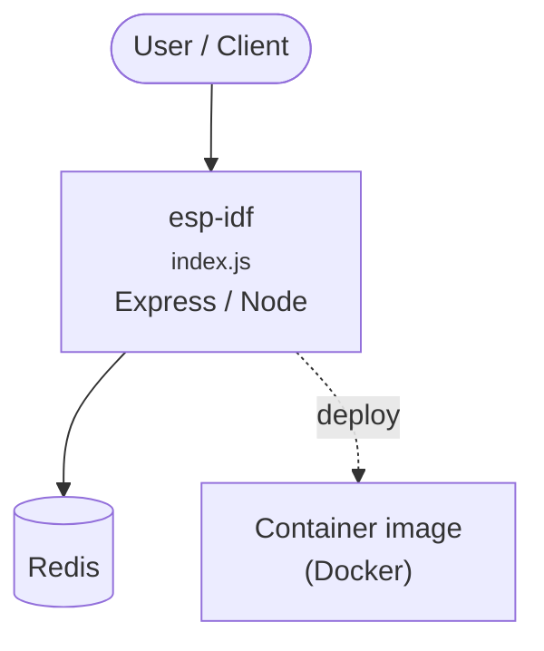

# Context Map — `esp-idf`

> Auto-generated architecture & deployment context map. Summarizes the core application, container/cloud footprint, and database connections. Regenerate after significant structural changes.

**Repo:** `avnit/esp-idf` · **Fork** · Public · Primary language: C · Default branch: `master` · Files: 21025

**Description:** Espressif IoT Development Framework. Official development framework for Espressif SoCs.

## 1. Core application

Espressif IoT Development Framework

- **Frameworks / runtime:** Express / Node
- **Entry points:** `examples/protocols/http_server/restful_server/front/web-demo/src/plugins/index.js`, `examples/protocols/http_server/restful_server/front/web-demo/src/router/index.js`, `examples/protocols/http_server/restful_server/front/web-demo/src/stores/index.js`, `tools/ble/ble_uart_bridge/main.py`, `tools/ble/ble_uart_bridge/src/daemon/server.py`, `tools/ci/idf_ci_local/app.py`
- **Listens on port(s):** 2121, 5002

## 2. Containers & cloud applications

**Containers:**
- `tools/docker/Dockerfile`

## 3. Database connections

**Datastores in use:** Redis

**Referenced in:**
- `tools/ci/configure_ci_environment.sh`

## 4. Architecture diagram

## 5. Security posture

- **Static scan findings:** 60 critical, 51 high, 13 medium

| Severity | Rule | File:Line |
|---|---|---|
| critical | private-key-block | `components/esp-tls/test_apps/main/test_esp_tls.c:35` |
| critical | private-key-block | `components/esp_hal_security/test_apps/crypto/main/ecdsa/ecdsa192_priv_key.pem:1` |
| critical | private-key-block | `components/esp_hal_security/test_apps/crypto/main/ecdsa/ecdsa256_priv_key.pem:1` |
| critical | private-key-block | `components/esp_hal_security/test_apps/crypto/main/ecdsa/ecdsa384_priv_key.pem:1` |
| critical | private-key-block | `components/esp_hal_security/test_apps/crypto/main/key_manager/ecdsa_192_key.pem:1` |
| critical | private-key-block | `components/esp_hal_security/test_apps/crypto/main/key_manager/ecdsa_256_key.pem:1` |
| critical | private-key-block | `components/esp_hal_security/test_apps/crypto/main/key_manager/ecdsa_384_key.pem:1` |
| critical | private-key-block | `components/esp_tee/test_apps/tee_cli_app/test_certs/server_key.pem:1` |

---
_Generated by repo context-mapping pass on 2026-08-13._